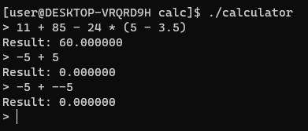

[Русская версия](README.ru.md)

# Assembly Calculator

A cross-platform console calculator written from scratch in x86-64 assembly using MASM/UASM syntax. This project demonstrates a low-level implementation of classic expression parsing and evaluation algorithms, as well as the construction of a modular architecture in assembly.



## Features

- **Basic Arithmetic Operations:** Addition (`+`), subtraction (`-`), multiplication (`*`), division (`/`).
- **Operator Precedence:** Correctly handles the order of operations (multiplication and division are performed before addition and subtraction).
- **Parentheses Support:** Allows overriding the order of operations using parentheses.
- **Unary Minus:** Supports negative numbers and expressions like `5 * -2`.
- **Floating-Point Numbers:** All calculations are performed with 64-bit double-precision numbers using SSE2 instructions.
- **Division by Zero:** Returns `inf` in accordance with the IEEE 754 standard.
- **Error Reporting:** Invalid characters, malformed numbers, unbalanced parentheses, missing operands and over-long expressions are all reported instead of producing a wrong result silently.
- **Cross-Platform:** The code compiles on Linux and can be easily adapted for Windows due to its use of the standard C library (libc/MSVCRT).

## Architecture

The project features a clean, modular architecture that separates responsibilities between components:

1.  **`lexer.asm` (Lexer):** Responsible for lexical analysis. It converts the input string into a sequence of tokens (numbers, operators, parentheses).
2.  **`parser` (Parser, in `calculator.asm`):** Responsible for syntax analysis. It uses the **Shunting-yard algorithm** to convert the token sequence into Reverse Polish Notation (RPN), respecting operator precedence and parentheses.
3.  **`evaluator.asm` (Evaluator):** Evaluates the expression represented in RPN using a stack-based calculator.
4.  **`calculator.asm` (Main Module):** Orchestrates the entire process: gets user input, calls the modules in sequence, and prints the final result.
5.  **`common.inc`:** A common header file containing the `Token` structure definition.

## Building and Running

**Prerequisites:**
- `UASM` assembler (version 2.57+)
- `GCC` compiler (for linking)

**Build Instructions:**

The repository includes a `build.sh` script for convenience.

1.  Make the script executable:
    ```bash
    chmod +x build.sh
    ```
2.  Run the script:
    ```bash
    ./build.sh
    ```
    This will automatically assemble all modules and link them into a single executable named `calculator`.

    To remove the build artifacts run `./build.sh clean`.

**Manual Build:**
```bash
# 1. Assemble all modules
uasm -elf64 lexer.asm
uasm -elf64 evaluator.asm
uasm -elf64 calculator.asm

# 2. Link the object files using GCC
#    -z noexecstack keeps the stack non-executable (UASM emits no .note.GNU-stack)
gcc -no-pie -z noexecstack calculator.o lexer.o evaluator.o -o calculator -lm
```

**Running:**
```bash
./calculator
```

**Limits:** an expression may contain up to 64 tokens and an input line up to 254 characters.

## Testing

The regression suite drives the built binary and checks both the results and the error messages:

```bash
./tests/test_calculator.sh
```
